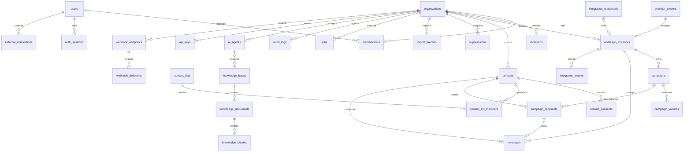

# Arquitetura do SaaS — DisparaZap

| | |
|---|---|
| **Status** | 🟡 Proposta — **aguardando aprovação** do dono do produto |
| **Data** | 2026-10-31 |
| **Base** | [AUDITORIA_INICIAL.md](AUDITORIA_INICIAL.md) + verificação de segurança desta data (seção 1) |
| **Implantação** | [PLANO_IMPLANTACAO_HOSTINGER.md](PLANO_IMPLANTACAO_HOSTINGER.md) |
| **Decisões** | Registradas em [DISPARAZAP_MASTER.md](DISPARAZAP_MASTER.md) |

> Nenhum código, migration, dependência ou servidor foi criado ou alterado para produzir este documento.
> Endpoints do Evolution Go citados aqui vêm de `doc_evolution_go.md` e **precisam ser confirmados na versão instalada**
> antes de qualquer implementação (seção 5.2). Nenhum endpoint da Zernio é presumido.

---

## 1. Diagnóstico atualizado do MVP (2026-10-31)

### 1.1 Estado do código frente à auditoria

| Item | Situação |
|---|---|
| `server.js` (189 linhas) e `index.html` (1.509 linhas) | Inalterados desde 2026-10-30, iguais ao auditado |
| Dependências | express 4.22.3 e dotenv 16.6.1; `npm audit`: 0 vulnerabilidades; versões mais novas existem (express 5, dotenv 18), sem urgência |
| Git | Continua sem repositório |
| **Errata** | **`.env.example` não existe.** A auditoria o listou por engano; ele já não estava na pasta no início da auditoria (provavelmente foi renomeado para `.env` em vez de copiado). Precisa ser recriado |

### 1.2 Verificação de segurança

Os testes foram feitos localmente com uma cópia do servidor apontando para um Evolution **falso**. Nenhuma mensagem real foi enviada
e o servidor real não foi contatado.

| # | Risco verificado | Resultado | Evidência | Severidade |
|---|---|---|---|---|
| V1 | Servidor acessível pela rede sem login | **Confirmado** | Escuta em `::` (todas as interfaces); `/api/instances` respondeu pelo IP da rede local | 🔴 Crítica |
| V2 | Sem validação TLS com o Evolution | **Confirmado** | `rejectUnauthorized: false` vale para todas as chamadas HTTPS | 🟠 Alta |
| V3 | Exposição de tokens e dados | **Confirmado (parcial)** | O filtro remove só campos de primeiro nível: campos aninhados (ex.: `settings.webhookToken`), `proxy` com usuário/senha na URL e `qrcode` passam para o navegador; `jid` expõe o número de cada instância. Tokens de instância ficam em texto puro no `localStorage` | 🟠 Alta |
| V4 | Envio não autorizado | **Possível com token** | Quem alcança o servidor e tem um token dispara sem limite: 30/30 requisições seguidas foram repassadas. O intervalo anti-banimento existe **só no navegador**; chamando a rota direto ele é ignorado | 🟠 Alta |
| V5 | Abuso / limite de taxa | **Confirmado** | Nenhum limite por IP, token ou instância; nenhum registro no servidor de quem enviou o quê | 🟠 Alta |
| V6 | DNS rebinding | **Possível** | Requisição com `Host: evil.example` foi aceita (200). Sem validação de `Host`, um site malicioso pode ler `/api/instances` via rebinding | 🟡 Média |
| V7 | Normalização de telefones | **Falha** | Aceitou 8 de 9 entradas inválidas: sem DDI (`11988887777`), zero de tronco (`011…`), fixo sem DDI, dois números colados de uma célula, qualquer sequência de 10 dígitos | 🟡 Média (risco de envio ao destinatário errado) |
| V8 | Dependências externas / CDN | **Risco baixo hoje** | SheetJS 0.20.3 via CDN sem SRI e sem CSP. Atenção: o pacote `xlsx` do **npm** está parado na 0.18.5, com vulnerabilidades conhecidas (prototype pollution e ReDoS); no SaaS, usar o pacote distribuído pela própria SheetJS | 🟡 Baixa |
| V9 | Cabeçalhos de segurança | **Ausentes** | Sem CSP, `X-Frame-Options`, `X-Content-Type-Options`, `Referrer-Policy` | 🟡 Baixa |
| V10 | CORS | ✅ Seguro | Preflight de outra origem recebe 404, sem `Access-Control-Allow-Origin` | — |
| V11 | CSRF | ✅ Mitigado | Formulário `text/plain` sem header → 401; o header `X-Instance-Token` + JSON forçam preflight | — |
| V12 | XSS | ✅ Mitigado | Os 10 usos de `innerHTML` passam por `esc()` ou só recebem valores internos | — |
| V13 | Corpo grande | ✅ Mitigado | Corpo de 2 MB → 413 | — |
| V14 | Firewall do Windows | ⚪ Não verificado | Consulta às regras exige privilégio de administrador | — |

### 1.3 Riscos críticos (resumo)

1. **Qualquer dispositivo na mesma rede usa o servidor** com a chave global (V1) — e, com um token, dispara sem limite (V4/V5).
2. **Credenciais podem vazar para o navegador** por campos aninhados ou URL de proxy (V3).
3. **Conexão com o Evolution aceita certificado falso** (V2): a chave global trafega sem garantia de destino.
4. **Telefone mal normalizado** envia para a pessoa errada (V7).
5. **Sem rastreabilidade**: não há registro de envios no servidor — inviável para LGPD e para investigar abuso.

As correções rápidas do MVP (V1, V2, V3, V6, V7, `.env.example`) **não foram aplicadas** nesta execução, por restrição.
Elas estão na Etapa 0 do plano (seção 11) e dependem de autorização.

---

## 2. Requisitos que guiam a arquitetura

| Requisito | Origem |
|---|---|
| Multiempresa com isolamento rígido de dados | Visão SaaS |
| Super Admin, empresas, usuários e papéis | Visão SaaS |
| Disparos sobrevivem a fechamento de navegador, queda e reinício | Auditoria L1 |
| Credenciais de integração nunca chegam ao navegador | Princípio 2 do MASTER |
| Integrações independentes e substituíveis (Evolution, Zernio, IA) | Princípio 3 do MASTER |
| API REST versionada + webhooks autenticados para integrar a MyLinksss | Visão SaaS |
| Uma VPS Hostinger, operada por equipe pequena | Decisão de infraestrutura |
| O MVP atual continua funcionando durante a construção | Prompt da Fase 2 |

---

## 3. Arquitetura recomendada

### 3.1 Visão geral — monólito modular

Um **único código-fonte** (TypeScript), com **dois processos** a partir da mesma imagem: `api` (HTTP) e `worker` (filas).
Os módulos têm fronteiras explícitas e podem virar serviços separados no futuro, se for necessário.
Microsserviços agora só trariam custo operacional sem benefício para o porte atual.

```
                    Internet
                       │ 443
               ┌───────▼────────┐
               │ Caddy (HTTPS)  │  app.<dominio>
               └───┬────────┬───┘
         estáticos │        │ /api/*
          ┌────────▼──┐  ┌──▼─────────────────────────────────────────┐
          │ web (SPA) │  │ api (Node + TS)                             │
          └───────────┘  │ auth · orgs · whatsapp · contacts ·         │
                         │ campaigns · public-api · webhooks · audit   │
                         └──┬──────────────┬──────────────┬────────────┘
                            │              │ enfileira    │ HTTP (rede privada)
                    ┌───────▼──────┐ ┌─────▼─────┐   ┌────▼──────────┐
                    │ PostgreSQL   │ │ Redis     │   │ Evolution Go  │
                    │ (verdade)    │ │ (filas)   │   │ (topologia a  │
                    └───────▲──────┘ └─────┬─────┘   │  verificar)   │
                            │              │         └────▲──────────┘
                         ┌──┴──────────────▼──┐           │
                         │ worker (Node + TS) │───────────┘
                         │ campanhas · webhooks│
                         │ sincronização       │
                         └─────────────────────┘
```

### 3.2 Stack proposta

| Camada | Recomendação | Alternativa considerada | Por que a recomendação |
|---|---|---|---|
| Runtime | **Node.js 24 LTS** + TypeScript `strict` | Bun, Deno | Mesmo runtime do MVP e da máquina local; ecossistema maduro |
| Framework HTTP | **Fastify 5** + Zod (validação e tipos) | Express 5; NestJS | Validação por schema nativa, plugins encapsulados (combinam com módulos), geração de OpenAPI. Express não valida nem tipa; NestJS traz muita cerimônia para uma equipe pequena |
| Acesso a dados | **Drizzle ORM** + drizzle-kit (migrations em SQL legível) | Prisma; Kysely | SQL explícito facilita Row Level Security e índices parciais; Prisma dificulta `SET LOCAL` por transação para RLS |
| Banco | **PostgreSQL 17** (+ `citext`; `pgvector` no futuro) | MySQL | RLS, índices parciais, JSONB, pgvector para agentes de IA |
| Fila | **Redis 7 + BullMQ**, com o PostgreSQL como fonte da verdade | pg-boss (fila no próprio Postgres) | Atraso agendado, tentativas, limite de taxa e painel prontos. A tabela `jobs` no Postgres permite reconstruir a fila se o Redis se perder. pg-boss é a alternativa se quisermos um serviço a menos na VPS (**decisão D5**) |
| Frontend | **React + Vite + TypeScript** (SPA), TanStack Query | Next.js | O painel fica todo atrás de login, então não precisa de renderização no servidor; a SPA é servida como estáticos pelo Caddy |
| Proxy / HTTPS | **Caddy 2** (certificados automáticos) | Traefik; Nginx + certbot | Configuração mínima, HTTPS e renovação automáticos |
| Logs | **pino** (JSON) com redação de campos sensíveis | winston | Rápido e estruturado |
| Testes | **Vitest** + Testcontainers (Postgres/Redis reais) + simulador do Evolution; Playwright para e2e | Jest | Rápido e nativo de TS; testes de integração com banco real |
| Containers | **Docker Compose** (dev, homologação e produção) | Kubernetes, Swarm | Proporcional a uma VPS |

### 3.3 Estrutura do repositório (proposta — decisão D2)

O SaaS nasce em uma pasta própria, **sem tocar no MVP** da raiz:

```
disparazap/
├── server.js, index.html, package.json   ← MVP atual, intocado até o SaaS substituí-lo
├── docs/
└── saas/
    ├── apps/
    │   ├── api/          # Fastify: src/server.ts (HTTP) e src/worker.ts (filas)
    │   │   └── src/
    │   │       ├── modules/      # auth, users, organizations, whatsapp, contacts,
    │   │       │                 # campaigns, messaging, integrations, public-api,
    │   │       │                 # webhooks, audit  (+ agents, knowledge, social: futuros)
    │   │       └── platform/     # db, redis, queue, crypto (cofre), config, logger, http
    │   └── web/          # React + Vite
    ├── packages/
    │   └── shared/       # schemas Zod, tipos, papéis, enums de status
    └── infra/            # compose.*.yml, Caddyfile, scripts de backup/deploy
```

**Regras de fronteira:** um módulo só acessa as tabelas dele; outros módulos usam a interface pública (serviço exportado).
Integrações externas ficam atrás de **adaptadores** (`WhatsAppProvider`, `SocialProvider`, `AiProvider`).

### 3.4 Superfícies de API

| Prefixo | Quem usa | Autenticação | Estabilidade |
|---|---|---|---|
| `/api/internal/*` | Painel web | Sessão (cookie) + proteção CSRF | Pode mudar junto com o frontend |
| `/api/v1/*` | MyLinksss e outras integrações | API key por empresa, com escopos | Contrato público versionado (OpenAPI 3.1); quebra só em `/v2` |
| `/hooks/*` | Evolution Go (e futuros provedores) | Segredo por instância + rede privada (seção 5.3) | Interno |
| `/health/*` | Docker, monitoramento | Nenhuma (sem dados sensíveis) | — |

Erros no formato **RFC 9457** (`application/problem+json`); paginação por cursor; `Idempotency-Key` em POSTs públicos.

---

## 4. Autenticação, autorização e multi-tenancy

### 4.1 Autenticação (painel)

| Item | Proposta |
|---|---|
| Senhas | **argon2id**; mínimo de 12 caracteres; bloqueio progressivo após falhas; limite de taxa no login |
| Sessão | Token opaco de 256 bits em cookie `__Host-dz_session` (`Secure`, `HttpOnly`, `SameSite=Lax`); só o **hash** fica no banco (`auth_sessions`) |
| Expiração | 12 h de inatividade, 7 dias absolutos; rotação no login e na troca de privilégio; revogar todas ao trocar a senha |
| CSRF | `SameSite=Lax` + verificação de `Origin` + token CSRF em requisições que alteram estado |
| 2FA | TOTP **obrigatório** para Super Admin; opcional (configurável por empresa) para os demais |
| Primeiro Super Admin | Criado por **comando de linha** no servidor (senha digitada na hora); nunca há usuário/senha padrão |
| Convites | Token de uso único, com hash no banco e expiração de 72 h |
| Biblioteca | Implementação própria enxuta sobre as peças acima. Alternativa a avaliar: Better Auth (tem plugins de organização e 2FA), que porém imporia o próprio esquema de tabelas (**decisão D3**) |

**Por que sessão e não JWT:** o painel é first-party. Sessão no servidor é revogável na hora e não deixa token acessível a JavaScript.

### 4.2 Autorização (RBAC)

| Papel | Escopo | Pode |
|---|---|---|
| **Super Admin** | Plataforma (`users.is_platform_admin`) | Empresas, servidores Evolution, suspensões, auditoria global. Ações em dados de uma empresa ficam registradas |
| **Owner** | Empresa | Tudo na empresa, incluindo membros, cobrança futura e exclusão da empresa |
| **Admin** | Empresa | Membros (exceto owner), instâncias, integrações, API keys, webhooks |
| **Operator** | Empresa | Contatos, listas, campanhas, acompanhamento |
| **Viewer** | Empresa | Somente leitura |

- As permissões são strings (`campaign:start`, `instance:create`, `apikey:manage`…) mapeadas a partir dos papéis **no código**, verificadas em toda rota.
- As API keys têm **escopos** (`contacts:write`, `campaigns:read`…) e nunca valem mais que o papel de quem as criou.

### 4.3 Isolamento multi-tenant

**Modelo:** banco e esquema compartilhados, com `organization_id` em toda tabela de dados de empresa e **duas camadas de defesa**:

1. **Aplicação:** a empresa ativa vem da rota (`/api/internal/orgs/:orgId/...`) ou da API key. Um middleware confirma que
   o usuário é membro com papel suficiente, e todo repositório exige `organizationId`.
2. **Banco (Row Level Security):** políticas `organization_id = current_setting('app.org_id')::uuid` em todas as tabelas de empresa.
   A aplicação conecta com o papel `dz_app` (sem `BYPASSRLS` e sem ser dono das tabelas) e define `SET LOCAL app.org_id` em cada transação.
   O worker faz o mesmo a partir do job.
3. **Referências entre tabelas** usam chave composta `(organization_id, id)`, então é impossível ligar um registro a outro de outra empresa.
4. **Operações de plataforma** (Super Admin) usam um pool separado, com o papel `dz_platform`, só dentro do módulo de plataforma, sempre auditadas.
5. **Teste obrigatório de isolamento:** para cada rota, um teste automatizado garante que a empresa A não lê nem altera dados da empresa B.

---

## 5. Integrações

### 5.1 Adaptador Evolution Go

- **Interface** `WhatsAppProvider` com operações de negócio (`createInstance`, `startConnection`, `getQrCode`, `getStatus`,
  `sendText`, `deleteInstance`…). O restante do sistema não conhece URLs nem headers do Evolution.
- **Credenciais:**
  - A chave global de cada servidor Evolution existe **só** em segredo do servidor (seção 9 do plano de implantação), nunca no banco nem no navegador.
    **Revisto em 2026-11-01:** a pedido do dono do produto, a chave é informada pelo Super-Admin na tela e guardada **cifrada**
    no banco, com a chave-mestra fora dele. Continua nunca indo ao navegador ([DECISOES_TECNICAS D-25](../saas/docs/DECISOES_TECNICAS.md)).
  - O token de cada instância é **gerado pelo DisparaZap** (aleatório, 32 bytes) e guardado criptografado em `integration_credentials`.
- **Nomes de instância** em servidor compartilhado: `dz_<org_curto>_<aleatório>`, o que evita colisão entre empresas.
- **TLS:** verificação **ligada**. Se o Evolution estiver na mesma VPS, a comunicação é HTTP pela rede Docker privada, sem exposição.
  Se estiver em outro servidor, HTTPS com certificado válido e liberação só para o IP da VPS do DisparaZap.
- **Resiliência:**
  - Timeout por operação.
  - Disjuntor por instância: pausa as campanhas da instância se ela desconectar ou se a taxa de falhas subir.
  - **Nunca repetir automaticamente um envio cujo resultado é incerto** (timeout depois de a requisição ter saído), porque o Evolution pode ter enviado.
    O destinatário fica como `unknown` para decisão manual. Só se repete quando a falha comprovadamente aconteceu antes do envio (ex.: conexão recusada).
- **Instâncias existentes** (criadas no MVP via curl) podem ser **adotadas** por uma empresa pelo Super Admin, sem recriar.

### 5.2 Endpoints do Evolution Go — situação de verificação

Fonte: `doc_evolution_go.md`. **Nenhum endpoint marcado ⬜ deve ser implementado antes de confirmado** no Swagger da versão
instalada (a documentação indica `/swagger/index.html`) e em homologação.

**Atualização de 2026-11-01 (etapa W1 do [plano do módulo WhatsApp](../saas/docs/PLANO_MODULO_WHATSAPP.md)):**
- o Swagger da versão instalada (`/swagger/doc.json`, versão declarada "1.0") foi lido, sem chave e sem criar nada;
- as rotas de instância foram confirmadas ali e implementadas **contra o simulador**;
- o uso real (homologação, W3) ainda depende de autorização do dono do produto;
- o Swagger não tipa as respostas (`gin.H`), por isso os campos das respostas só se confirmam na homologação.

**Atualização de 2026-11-01, à noite:**
- o dono do produto criou instâncias reais pelo painel e conectou números, e o uso mostrou que o `/instance/status` não traz o
  número;
- os formatos das respostas foram então conferidos no **código-fonte público** da Evolution Go (`pkg/instance`,
  `pkg/sendMessage`), sem acessar o servidor;
- detalhes em DECISOES_TECNICAS D-38.

| Endpoint | Uso no SaaS | Swagger da versão instalada | Testado no servidor real? |
|---|---|---|---|
| `GET /instance/all` | Sincronizar instâncias; teste de conexão | ✅ Confirmado | ✅ Sim (2026-10-30) |
| `POST /send/text` | Enviar texto (MVP e Envio de Mensagens do SaaS) | ✅ `{ number, text, delay }`. Pelo código-fonte: resposta `data.Info.ID`; falhas como HTTP 500 com `{"error"}` ("no active session found", "… is not registered on WhatsApp") | 🟨 Em uso real pelo MVP; o SaaS só contra simulador |
| `POST /send/media` | Imagem com legenda (Envio de Mensagens) | ✅ `{ number, type, url, caption, filename }`. Pelo código-fonte: `url` sem http(s) é base64 puro; imagem jpeg/png/webp | ⬜ Só contra simulador |
| `POST /send/button` | Botão de CTA (não usado: escolha do dono do produto pelo link no texto) | ✅ Botões `reply`/`copy`/`url`/`call`/`pix`; título, descrição e rodapé obrigatórios; imagem só com botões de resposta | ⬜ Não |
| `GET /instance/info/{instanceId}` | Número conectado (`jid`) e estado ao vivo de uma instância | ✅ Confirmado; modelo `Instance` lido no código-fonte | ⬜ Não |
| `POST /instance/create` | Criar instância | ✅ `{ name, token, instanceId?, advancedSettings?, proxy? }`, chave global | 🟨 Usado com sucesso no uso real do dono do produto pelo painel (2026-11-01, segundo o log da API) |
| `POST /instance/connect` | Iniciar conexão (webhook omitido) | ✅ `{ webhookUrl, subscribe, immediate, phone, … }`; os nomes de webhook diferem dos da criação no `doc_evolution_go.md` | 🟨 Usado com sucesso no uso real do dono do produto pelo painel (2026-11-01, segundo o log da API) |
| `GET /instance/qr` | QR Code | ✅ Confirmado | 🟨 Usado com sucesso no uso real do dono do produto pelo painel (2026-11-01, segundo o log da API) |
| `POST /instance/pair` | Código de pareamento | ✅ `{ phone, subscribe }` | 🟨 Usado com sucesso no uso real do dono do produto pelo painel (2026-11-01, segundo o log da API) |
| `GET /instance/status` | Status | ✅ Rota confirmada. Pelo código-fonte (2026-11-01): `data.Connected`, `data.LoggedIn` e `data.Name`, **sem o número** (o `myJid` da documentação não é enviado) | 🟨 Usado pelo painel no uso real do dono do produto (2026-11-01) |
| `DELETE /instance/logout` | Desconectar | ✅ Existe (não aparece no `doc_evolution_go.md`). Há também `POST /instance/disconnect` e `/reconnect` | ⬜ Não (W3) |
| `DELETE /instance/delete/{instanceId}` | Excluir instância | ✅ **Pelo ID**, não pelo nome como a documentação sugeria | ⬜ Não (W3) |
| `POST /user/check` | Verificar se o número tem WhatsApp | Não consultado | ⬜ Não |
| Webhook / WebSocket / RabbitMQ / NATS | Receber eventos | Não consultado | ⬜ Não. Formato, autenticação e entrega precisam de teste |

### 5.3 Eventos de entrada (webhooks do Evolution)

- Ainda não se sabe se o Evolution Go **assina** os webhooks; a documentação não mostra assinatura. Proteção proposta,
  independente disso:
  1. URL com segredo por instância (`/hooks/evolution/<id_público>/<segredo>`);
  2. de preferência, recebimento pela rede privada Docker;
  3. validação de que o evento pertence a uma instância conhecida.
- Todo evento é gravado em `integration_events` com chave de deduplicação, confirmado rápido (200) e processado no worker.
- Eventos permitem: status de entrega/leitura, mensagens recebidas, palavras de descadastro (ex.: "SAIR") → `suppressions`.

### 5.4 Zernio (planejado — não implementar nesta fase)

> **Atualização 2026-11-02:** a documentação oficial está resumida em `saas/docs/REFERENCIA_ZERNIO.md`, e o plano da
> integração (conta Zernio própria por empresa, configurada em Integrações) está em `saas/docs/PLANO_MODULO_ZERNIO.md`,
> aprovado e implementado (Z1) em 2026-11-02 contra a Zernio simulada (DECISOES_TECNICAS D-46).

- Integração **independente** do Evolution, com conexão **por conta de usuário** (`external_connections`).
- Interface `SocialProvider` será definida **somente depois** de a documentação oficial da Zernio estar no repositório e as
  operações necessárias serem confirmadas (publicação, mensagens, comentários). Nenhum endpoint é presumido.

### 5.5 Agentes de IA (planejado — não implementar nesta fase)

- Dependem do recebimento de mensagens (5.3).
- Componentes previstos:
  - **agente:** personalidade, regras, horário e transferência para humano;
  - **base de conhecimento:** documentos, trechos e embeddings no `pgvector`;
  - **interface `AiProvider`:** provedor a definir (decisão D9).
- Controles previstos: limite de custo por empresa, registro de cada resposta gerada e opção de revisão humana.

---

## 6. Motor de campanhas e filas

**Princípio:** o PostgreSQL guarda o estado; o Redis apenas agenda. Se o Redis for perdido, um *reconciliador* recria a fila a partir do banco.

```
draft ──► scheduled ──► running ◄──► paused
                           │
                           ├──► completed
                           ├──► canceled
                           └──► failed (instância caiu / disjuntor)
```

1. **Início:** em uma transação, os destinatários são "congelados" em `campaign_recipients`. Ficam só contatos com consentimento
   válido, fora da lista de supressão, com telefone E.164 válido e sem duplicados. Em seguida o primeiro job é criado.
2. **Envio encadeado e cadenciado:** cada job envia **um** destinatário e agenda o próximo com atraso aleatório entre mínimo e máximo
   (a mesma regra do MVP, agora no servidor). Antes de cada envio, o worker relê o status da campanha (pausa/cancelamento imediatos).
3. **Uma campanha ativa por instância:** índice único parcial `campaigns(instance_id) WHERE status = 'running'`.
   Assim o ritmo de uma instância não dobra.
4. **Limites anti-banimento por instância:** teto diário configurável e janela de horário permitida.
5. **Idempotência:** cada destinatário tem `idempotency_key` e transição de estado atômica
   (`pending → sending → sent | failed | unknown`), selecionada com `FOR UPDATE SKIP LOCKED`.
6. **Campanha de teste:** `is_test = true` envia só para contatos marcados como destinatários de teste (até 5).
   Proposta: toda instância nova precisa concluir uma campanha de teste antes da primeira campanha real (**decisão D7**).
7. **Configuração do Redis:** persistência AOF e `maxmemory-policy noeviction`, exigido pelo BullMQ para não perder jobs.

---

## 7. API pública e webhooks de saída (preparação para MyLinksss)

- **API keys:**
  - Prefixo visível (ex.: `dz_live_ab12…`) para identificação.
  - O banco guarda só o HMAC-SHA256 da chave; a chave completa aparece **uma única vez**, na criação.
  - Têm escopos, expiração opcional e `last_used_at`.
- **Primeiros endpoints `/api/v1`** (propostos):
  - `GET /v1/me`
  - `POST /v1/contacts` (upsert, com registro de consentimento obrigatório)
  - `GET /v1/contacts/{id}`
  - `POST /v1/lists/{id}/members`
  - `GET /v1/campaigns/{id}`

  Disparo de campanha via API fica para depois do MVP.
- **Webhooks de saída:**
  - **Eventos:** `campaign.started|completed|failed`, `message.sent|failed`, `contact.opted_out`, `instance.disconnected`.
  - **Assinatura:** `X-DisparaZap-Signature: t=<timestamp>,v1=<HMAC-SHA256(segredo, t + "." + corpo)>`, com janela anti-replay de 5 minutos
    e `event_id` para o receptor descartar repetições.
  - **Retentativas:** recuo exponencial por até 24 h; o endpoint é desativado automaticamente após falhas consecutivas e há registro em `webhook_deliveries`.
  - **Proteção SSRF:** URLs de webhook só com HTTPS; bloquear destinos internos (localhost, redes privadas RFC 1918, link-local,
    `169.254.169.254`), checando o IP **resolvido** no momento do envio.
- A MyLinksss **não é modificada**. O DisparaZap só oferece a API e os webhooks; o lado da MyLinksss será planejado à parte.

---

## 8. Modelo de dados (proposta — sem migrations)

### 8.1 Convenções

- `id uuid` (UUIDv7, gerado na aplicação: ordenado no tempo, bom para índices, não enumerável).
- `organization_id uuid NOT NULL` em toda tabela de empresa + RLS + chave composta `(organization_id, id)`.
- `created_at`/`updated_at timestamptz`; `deleted_at timestamptz` onde há exclusão lógica.
- Estados como `text` + `CHECK` (mais fácil de evoluir que `ENUM`).
- Telefones sempre em **E.164** (`+5511988887777`), validados com `libphonenumber-js` (país padrão configurável, BR).
- Segredos **nunca** em texto puro: criptografados no cofre (`integration_credentials`) ou guardados só como hash.

### 8.2 Diagrama de relacionamentos



### 8.3 Entidades

**Identidade e acesso**

| Tabela | Colunas principais | Restrições e índices | Exclusão |
|---|---|---|---|
| `users` | email (`citext`), name, password_hash, is_platform_admin, mfa_secret (cifrado), mfa_enabled_at, email_verified_at, status, last_login_at | único `email` onde `deleted_at IS NULL` | Lógica |
| `auth_sessions` | user_id, token_hash, active_organization_id, ip, user_agent, last_seen_at, expires_at, revoked_at | único `token_hash`; índice `(user_id)` onde não revogada | Revogação; limpeza periódica |
| `organizations` | name, slug, status (`active`/`suspended`), plan (futuro), settings `jsonb` (fuso, horário de envio, intervalos padrão) | único `slug` | Lógica (suspender antes de excluir) |
| `memberships` | organization_id, user_id, role, status, created_by | único `(organization_id, user_id)`; índice `(user_id)` | Por status |
| `invitations` | organization_id, email, role, token_hash, invited_by, expires_at, accepted_at, revoked_at | único `token_hash` | Expiração |

**WhatsApp e integrações**

| Tabela | Colunas principais | Restrições e índices | Exclusão |
|---|---|---|---|
| `provider_servers` *(plataforma)* | provider (`evolution_go`), name, base_url, secret_ref (nome do segredo, não o valor), verified_version, status | único `(provider, name)`; sem RLS, só Super Admin | Desativação |
| `whatsapp_instances` | organization_id, provider_server_id, provider_instance_name, display_name, phone_e164, status (`created`/`awaiting_qr`/`connected`/`disconnected`/`banned`), credential_id, daily_send_limit, last_status_at | único `(provider_server_id, provider_instance_name)`; índice `(organization_id, status)` | Lógica + exclusão no Evolution |
| `integration_credentials` | organization_id (nulo = plataforma), owner_user_id, provider, kind (`instance_token`/`oauth_token`/`api_key`/`signing_secret`), ciphertext, nonce, key_version, last4, expires_at, rotated_at, revoked_at | acesso só pelo módulo cofre; **nunca retornado pela API** | Revogação; dados cifrados apagados |
| `external_connections` | organization_id, user_id (dono da conta), provider (`zernio`), external_account_ref, platform, display_name, status, credential_id, connected_at, last_sync_at | único `(organization_id, provider, external_account_ref)` | Lógica + revogação da credencial |

**Contatos e consentimento**

| Tabela | Colunas principais | Restrições e índices | Exclusão |
|---|---|---|---|
| `contacts` | organization_id, phone_e164, name, attributes `jsonb`, source (`manual`/`import`/`api`/`inbound`), import_batch_id, is_test_recipient, consent_status (desnormalizado) | único `(organization_id, phone_e164)` onde `deleted_at IS NULL`; índice `(organization_id, created_at)` | Lógica; **anonimização** a pedido do titular (LGPD) |
| `contact_consents` | organization_id, contact_id, channel, action (`granted`/`revoked`), legal_basis, source, evidence `jsonb`, recorded_by, occurred_at | índice `(organization_id, contact_id, occurred_at DESC)` | **Somente inserção** (histórico) |
| `suppressions` | organization_id, phone_hash (HMAC do E.164), reason (`opt_out`/`complaint`/`manual`/`invalid`), created_by | único `(organization_id, phone_hash)` | Mantida mesmo após apagar o contato, para honrar o descadastro sem guardar o número |
| `contact_lists` | organization_id, name, description | índice `(organization_id)` | Lógica |
| `contact_list_members` | organization_id, list_id, contact_id, added_by, added_at | PK `(list_id, contact_id)`; índice `(organization_id, contact_id)` | Física |
| `import_batches` | organization_id, file_name, status, total_rows, imported, ignored, duplicated, consent_declaration `jsonb`, created_by | índice `(organization_id, created_at)` | Retenção |

**Campanhas, mensagens e execução**

| Tabela | Colunas principais | Restrições e índices | Exclusão |
|---|---|---|---|
| `campaigns` | organization_id, instance_id, name, status, is_test, delay_min_ms, delay_max_ms, send_window `jsonb`, scheduled_at, started_at, finished_at, contadores (total/sent/failed), created_by | **único parcial `(instance_id)` onde `status='running'`**; índice `(organization_id, status, created_at DESC)` | Lógica (só fora de `running`) |
| `campaign_variants` | organization_id, campaign_id, label, body, weight | único `(campaign_id, label)` | Junto com a campanha |
| `campaign_recipients` | organization_id, campaign_id, contact_id, phone_e164 e nome (cópia no momento do disparo), status, variant_id, attempts, last_error, message_id, idempotency_key | único `(campaign_id, contact_id)`; único `idempotency_key`; índice `(campaign_id, status, id)` para o worker | Retenção |
| `messages` | organization_id, instance_id, contact_id, campaign_id, direction (`outbound`/`inbound`), body, provider_message_id, status, error, sent_at, delivered_at, read_at | único `(instance_id, provider_message_id)`; índice `(organization_id, contact_id, created_at DESC)`; particionar por mês quando crescer | Retenção + anonimização |
| `jobs` | organization_id, type, ref_type, ref_id, status, run_at, attempts, max_attempts, locked_by, locked_at, finished_at, last_error, payload `jsonb` | índice `(status, run_at)`; único parcial para evitar job duplicado por referência ativa | Retenção (ex.: 30 dias após concluir) |
| `audit_logs` | organization_id, actor_type (`user`/`api_key`/`system`/`platform_admin`), actor_id, action, target_type, target_id, ip, request_id, metadata `jsonb` | índice `(organization_id, created_at DESC)`; BRIN em `created_at`; particionado por mês | **Imutável**: papel da aplicação sem `UPDATE`/`DELETE` |
| `integration_events` | organization_id, provider, instance_id/connection_id, event_type, dedupe_key, payload `jsonb`, received_at, processed_at, error | único `(provider, dedupe_key)` | Retenção curta (30–90 dias) |

**Agentes de IA (planejado)**

| Tabela | Colunas principais | Observação |
|---|---|---|
| `ai_agents` | organization_id, name, persona, rules `jsonb` (limites, horário, transferência para humano), model_provider, model, status | Lógica |
| `agent_assignments` | organization_id, agent_id, instance_id, priority, active | Liga agente a canal |
| `knowledge_bases` / `agent_knowledge_bases` | organization_id, name, description / agent_id, knowledge_base_id | N:N agente ↔ base |
| `knowledge_documents` | organization_id, knowledge_base_id, title, source_type, storage_key, checksum, status | Arquivo em armazenamento de objetos, não no banco |
| `knowledge_chunks` | organization_id, document_id, position, content, embedding `vector(N)`, token_count | Índice HNSW (`pgvector`); dimensão depende do modelo escolhido |

**API e webhooks**

| Tabela | Colunas principais | Restrições e índices | Exclusão |
|---|---|---|---|
| `api_keys` | organization_id, name, prefix, key_hash, scopes `text[]`, created_by, last_used_at, last_used_ip, expires_at, revoked_at | único `prefix`; índice `(organization_id)` | Revogação |
| `webhook_endpoints` | organization_id, url, events `text[]`, signing_secret_id, status, consecutive_failures, disabled_reason | índice `(organization_id)` | Lógica |
| `webhook_deliveries` | organization_id, endpoint_id, event_id, event_type, payload `jsonb`, attempt, status, response_status, response_time_ms, next_retry_at, delivered_at | índice `(status, next_retry_at)`; criadas na mesma transação do evento (padrão *outbox*) | Retenção (30 dias) |

### 8.4 Segurança dos dados

| Dado | Tratamento |
|---|---|
| Senhas | argon2id |
| Tokens de sessão, convite e API key | Só hash (SHA-256/HMAC); o valor aparece uma única vez |
| Tokens de instância, credenciais Zernio, segredos de webhook, segredo TOTP | Criptografia AES-256-GCM com chave mestra fora do banco; `key_version` para rotação |
| Chave global do Evolution | ~~Somente em segredo do servidor; nunca no banco~~ **Revisto em 2026-11-01 (D-25):** AES-256-GCM no banco, como os tokens de instância; nunca no navegador |
| Telefones em supressão | HMAC com *pepper* do servidor (permite checar sem guardar o número) |
| Corpo de mensagens | Dado pessoal: retenção configurável por empresa; nunca em logs |
| Logs da aplicação | Redação automática de `authorization`, `cookie`, `apikey`, `token`, `password`, `secret` |

### 8.5 Exclusão lógica, LGPD e retenção

- **Exclusão lógica** (`deleted_at`): usuários, empresas, instâncias, contatos, listas, campanhas, agentes, bases de conhecimento, webhooks.
- **Nunca alterados:** `audit_logs`, `contact_consents`.
- **Pedido de eliminação do titular (LGPD):** exclusão lógica **não basta**. Um job anonimiza o contato:
  1. remove nome e telefone de `contacts`, `campaign_recipients` e `messages`;
  2. mantém o hash em `suppressions` para não voltar a contatar;
  3. registra a ação em `audit_logs`.
- **Retenção proposta** (ajustável por empresa): eventos de integração 90 dias; entregas de webhook 30 dias; jobs concluídos 30 dias;
  mensagens 12 meses; logs de auditoria 5 anos.

---

## 9. Segurança transversal

- **Cabeçalhos:**
  - `Content-Security-Policy` restritiva (sem `unsafe-inline` no SaaS);
  - `Strict-Transport-Security`;
  - `X-Content-Type-Options: nosniff`;
  - `Referrer-Policy: strict-origin-when-cross-origin`;
  - `frame-ancestors 'none'`.
- **Limites de taxa** por IP (login), por usuário, por API key e por empresa; **cotas** por plano no futuro.
- **Validação de `Host`/`Origin`** contra os domínios configurados.
- **CORS** fechado no painel (mesma origem); na API pública, liberado só para origens cadastradas, quando necessário.
- **Dependências:**
  - versões travadas (lockfile);
  - `npm audit` e atualização automatizada (ex.: Renovate/Dependabot) após a criação do repositório;
  - nada de bibliotecas por CDN no SaaS (tudo empacotado e verificado no build).
- **Contêineres:**
  - usuário não-root;
  - sistema de arquivos somente leitura quando possível;
  - imagens oficiais com versão fixa.
- **LGPD:** registro de consentimento com evidência, descadastro honrado em todos os canais, exportação e eliminação de dados do titular,
  e registro de quem acessou o quê.

---

## 10. Testes e qualidade

| Tipo | O que cobre |
|---|---|
| Unitários (Vitest) | Normalização de telefone, renderização de `{nome}`/variações, máquina de estados da campanha, permissões |
| Integração (Testcontainers) | Repositórios com Postgres real, **RLS e isolamento entre empresas**, fila com Redis real |
| Simulador do Evolution Go | O adaptador contra um servidor falso. Reaproveitar a ideia do simulador usado na validação do MVP |
| Contrato | OpenAPI gerado e validado em CI; testes de assinatura de webhook |
| E2E (Playwright) | Login → empresa → instância → contatos → campanha de teste |
| Segurança | Testes de autorização por papel e de isolamento em todas as rotas; varredura de dependências |

Nenhum teste automatizado faz envio real. Envios reais só em homologação, com números de teste e autorização.

---

## 11. Plano incremental do primeiro MVP SaaS

Cada etapa é pequena, testável e **não altera o MVP atual**. Só a etapa 0 mexe nos arquivos da raiz, e só com autorização.

| # | Etapa | Entrega | Critério de aceite |
|---|---|---|---|
| 0 | **Base e correções do MVP** | git + repositório privado; recriar `.env.example`; MVP escutando só em `127.0.0.1`, TLS verificado, filtro de campos sensíveis recursivo, normalização de telefone com DDI; testes do MVP versionados | Testes passam; nenhuma regressão no MVP |
| 1 | **Fundação técnica** | Estrutura `saas/`, TypeScript, lint, Vitest, Docker Compose de dev (Postgres + Redis), config validada por Zod, logs, `/health` | `docker compose up` sobe tudo; CI verde |
| 2 | **Autenticação e Super Admin** | `users`, `auth_sessions`, login/logout, argon2id, TOTP obrigatório para Super Admin, comando de criação do primeiro admin | Testes de sessão, bloqueio e 2FA |
| 3 | **Empresas e membros** | `organizations`, `memberships`, `invitations`; Super Admin cria empresa e convida o owner | Fluxo de convite completo |
| 4 | **Autorização no backend** | Middleware de RBAC, RLS ativo, chaves compostas, `audit_logs` | Teste de isolamento A×B em todas as rotas |
| 5 | **Banco próprio consolidado** | Migrations versionadas, papéis `dz_app`/`dz_platform`, backup/restauração testados em dev | Restauração de backup comprovada |
| 6 | **Conexão segura com o Evolution Go** | `provider_servers`, adaptador, cofre de credenciais, **verificação dos endpoints no Swagger da versão instalada** | Adaptador passa no simulador; checklist de endpoints confirmado em homologação |
| 7 | **Instâncias e QR Code** | Criar/adotar instância, QR Code/pareamento na tela, status, webhook de eventos | Instância de teste conectada em homologação |
| 8 | **Contatos autorizados** | `contacts`, consentimentos, supressão, listas, importação Excel (reaproveitando a lógica do MVP) com declaração de consentimento | Contato sem consentimento não entra em campanha |
| 9 | **Fila persistente, histórico e campanhas de teste** | `jobs`, `campaigns`, `campaign_recipients`, `messages`, worker cadenciado, pausa/retomada/cancelamento, reconciliador, campanha de teste | Reiniciar o worker no meio não duplica nem perde envios; campanha de teste até 5 números |
| 10 | **API preparada para integração** | `api_keys`, `/api/v1` inicial, OpenAPI, `webhook_endpoints`/`webhook_deliveries` com assinatura | Chamada autenticada por API key; webhook assinado verificado por um receptor de teste |

**Fora desta fase:** Zernio, agentes de IA, cobrança/planos e disparo de campanha via API.

---

## 12. Decisões que precisam de aprovação

| # | Decisão | Recomendação |
|---|---|---|
| D1 | Stack (seção 3.2) | Node 24 + TS, Fastify, Drizzle, PostgreSQL 17, Redis + BullMQ, React + Vite, Caddy |
| D2 | Onde o SaaS nasce | Pasta `saas/`, MVP intocado na raiz até a substituição |
| D3 | Autenticação | Implementação própria enxuta (sessão + argon2id + TOTP); Better Auth como alternativa |
| D4 | Servidor Evolution Go | Um servidor compartilhado, com o modelo já preparado para vários (`provider_servers`) |
| D5 | Fila | BullMQ + Redis (Postgres como verdade); pg-boss se quisermos um serviço a menos |
| D6 | Política de consentimento | Só contatos com consentimento registrado entram em campanhas reais |
| D7 | Campanha de teste obrigatória | Toda instância nova faz uma campanha de teste antes da primeira real |
| D8 | Correções rápidas no MVP (etapa 0) | Autorizar as correções de V1, V2, V3, V6 e V7 e a recriação do `.env.example` |
| D9 | Provedor de IA | Decidir só quando o módulo de agentes for planejado |
| D10 | Infraestrutura | Itens do [plano de implantação](PLANO_IMPLANTACAO_HOSTINGER.md#16-decisões-de-infraestrutura-que-precisam-de-aprovação) (domínio, homologação, backup externo, levantamento da VPS) |
